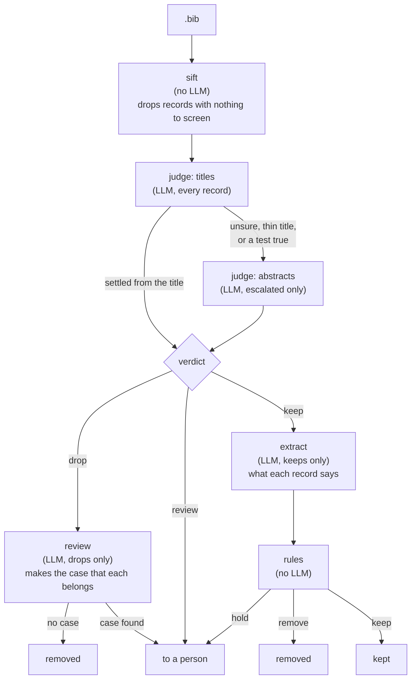

<p align="center">
 <br/>
</p>

-----

# Raven's paper tools

Thirteen command-line tools for the part of a literature review that happens before anyone reads anything: finding the papers, fetching them, repairing what the databases hand you, and setting aside what is not about your topic. One more is for afterwards: checking that what you wrote still matches the corpus it came from.

**This manual documents the rules the tools apply** — what counts as the same paper, when a record is dropped, what a merge keeps. For the pipeline itself, in the order you would run it, see [*Command-line tools*](../../README.md#command-line-tools) in the main README.

<!-- markdown-toc start - Don't edit this section. Run M-x markdown-toc-refresh-toc -->
**Contents**

- [The arXiv tools](#the-arxiv-tools)
    - [Identifiers and versions](#identifiers-and-versions)
    - [arXiv's rate limit, and why batching matters](#arxivs-rate-limit-and-why-batching-matters)
    - [When something goes wrong](#when-something-goes-wrong)
    - [What a rerun does](#what-a-rerun-does)
    - [Downloading](#downloading)
- [The converters — getting an export into BibTeX](#the-converters--getting-an-export-into-bibtex)
    - [`raven-wos2bib` — Web of Science](#raven-wos2bib--web-of-science)
    - [`raven-csv2bib` — a spreadsheet](#raven-csv2bib--a-spreadsheet)
    - [`raven-pdf2bib` — conference abstracts as PDFs](#raven-pdf2bib--conference-abstracts-as-pdfs)
- [`raven-fixbib` — repairing a database export](#raven-fixbib--repairing-a-database-export)
    - [What it repairs](#what-it-repairs)
    - [HTML that a database left in the values](#html-that-a-database-left-in-the-values)
    - [The publisher's rights notice](#the-publishers-rights-notice)
    - [What it reports](#what-it-reports)
- [`raven-deduplicate` — merging a multi-database search](#raven-deduplicate--merging-a-multi-database-search)
    - [What counts as the same paper](#what-counts-as-the-same-paper)
    - [What a DOI decides, and what it does not](#what-a-doi-decides-and-what-it-does-not)
    - [What a merge keeps](#what-a-merge-keeps)
    - [The audit](#the-audit)
    - [`--judge`: asking an LLM about the near misses](#--judge-asking-an-llm-about-the-near-misses)
    - [Why it errs toward leaving duplicates](#why-it-errs-toward-leaving-duplicates)
- [`raven-fillbib` — filling in abstracts from Crossref](#raven-fillbib--filling-in-abstracts-from-crossref)
    - [When an abstract is replaced](#when-an-abstract-is-replaced)
    - [What it cannot fill](#what-it-cannot-fill)
    - [Copyright](#copyright)
    - [What comes out](#what-comes-out)
- [`raven-siftbib` — removing what a review cannot screen](#raven-siftbib--removing-what-a-review-cannot-screen)
    - [Naming the criterion](#naming-the-criterion)
    - [What comes out, and the record of it](#what-comes-out-and-the-record-of-it)
- [`raven-scopebib` — telling which records are about what you searched for](#raven-scopebib--telling-which-records-are-about-what-you-searched-for)
    - [How it works, step by step](#how-it-works-step-by-step)
    - [Writing a definition file](#writing-a-definition-file)
    - [Calibrating with a pilot](#calibrating-with-a-pilot)
    - [What a run leaves](#what-a-run-leaves)
    - [The reviewer's control](#the-reviewers-control)
    - [Checking by hand, and `finish`](#checking-by-hand-and-finish)
    - [The run file, and repeating a run](#the-run-file-and-repeating-a-run)
    - [What starts a fresh ledger](#what-starts-a-fresh-ledger)
    - [Replicates and `compare`](#replicates-and-compare)
- [`raven-checkrefs` — does the document still match the corpus?](#raven-checkrefs--does-the-document-still-match-the-corpus)
    - [How a record is matched](#how-a-record-is-matched)
    - [The audit](#the-audit-1)
- [`raven-burstbib` — one file per record](#raven-burstbib--one-file-per-record)

<!-- markdown-toc end -->

## The arXiv tools

`raven-arxiv-search` finds papers, `raven-arxiv2id` reads identifiers out of the filenames you already have, `raven-arxiv2bib` turns identifiers into BibTeX, and `raven-arxiv-download` fetches the PDFs. The main README says what each one does; what follows is what they decide.

### Identifiers and versions

**A bare identifier means "whatever is current".** `2410.07866` asks for the newest version; `2410.07866v5` pins that one.

**What gets recorded is the version arXiv answered with**, however you spelled the request. Ask for the bare form and the BibTeX entry names the version you actually got, so a bibliography says which text the claims in it came from.

**That is what makes a collection refreshable.** `raven-arxiv2id --strip-versions` prints each identifier without its version suffix, and re-fetching those gets you whatever is current now. Scanning filenames without it keeps the newest version of each paper that you already have.

### arXiv's rate limit, and why batching matters

**Three seconds between requests is arXiv's requirement, not a tuning knob.** Raising it is fine; lowering it is a violation of their terms rather than a faster setting. It lives in `raven.papers.config.arxiv_request_delay` where a user can find it.

**The delay is charged per request, not per paper**, which is the whole reason metadata is fetched in batches — up to `arxiv_id_batch_size` (100) identifiers per request. A download of several hundred papers spends its politeness budget on a handful of requests rather than on one per paper.

**A search pages at 200 results and stops at 30,000**, the latter being arXiv's own ceiling however you page through it. A query expecting more than that needs splitting into narrower ones.

### When something goes wrong

**An identifier arXiv returns nothing for is reported at the end, not thrown.** One withdrawn or mistyped entry cannot cost the several hundred that worked.

**HTTP 429 is retried**, up to three attempts total, with backoff that honours a `Retry-After` header when the response carries one. Transport failures — dropped connections, read timeouts — are retried the same way.

**A malformed identifier fails in one line.** A typoed month like `2614.19062` reports "no arXiv entry for ID …" rather than a traceback, that being an expected outcome rather than a bug.

### What a rerun does

**Almost nothing, which is the point.** The summary is counted by outcome — downloaded, already present, duplicate identifier, no PDF available, failed — so running the same list again tells you it is already there rather than fetching it again.

**A repeated identifier is dropped before any metadata is fetched**, rather than being carried to the download step and skipped there. Both arXiv tools treat duplicates the same way.

### Downloading

**The citation is printed before the PDF is fetched** — `Authors (Year) - Title` — so it is on screen during the rate-limit wait, and a mistyped identifier that resolved to the wrong paper is visible before the file lands.

**Filenames keep clause boundaries.** A `:`, `?`, `!` or `;` followed by a space becomes ` - ` rather than being dropped, so a long title does not come out as a run-on sentence.

**`--save-bib file.bib` writes the metadata that was already fetched**, so downloading a set of papers and building its bibliography costs one set of politeness delays rather than two.

**`--from-bib file.bib` reads the identifiers out of a bibliography** instead of the command line. `raven-arxiv-search` writes its results as one, so a query becomes fulltext in two commands with no identifiers to shuffle in between.

## The converters — getting an export into BibTeX

All three write BibTeX to stdout, so redirect them, and all three read several inputs as one corpus.

### `raven-wos2bib` — Web of Science

Web of Science indexes the engineering sciences well, and exports plain text.

```bash
raven-wos2bib input1.txt ... inputn.txt 1>output.bib 2>log.txt
```

The inputs are `.txt` files exported from Web of Science; the BibTeX goes to stdout and the log — including warnings about broken input data — to stderr, so redirect both. The resulting `.bib` imports into Raven-visualizer.

**Two publication types are mapped**: `J` becomes `@article` and `B` becomes `@book`. Series and patents are not handled yet, so an export holding them needs a look.

**Author affiliations are normalized to one string.** Web of Science's `C1` field arrives in more than one shape depending on the export, and BibTeX has one field to put it in.

### `raven-csv2bib` — a spreadsheet

**The header row is the schema.** Each column name becomes a BibTeX field name verbatim, and each row becomes an `@article` — so a sheet with columns `author`, `year`, `title`, `abstract` converts without any mapping to configure, and a sheet with a column called `Notes on screening` produces a field of that name.

**The delimiter is autodetected** — tab or semicolon — and `-d` forces one. Values are BibTeX-escaped and braced on the way out.

**Entry keys are generated**, one UUID per row, since a spreadsheet rarely carries one. They are unique rather than memorable; if you want citable keys, set them afterwards.

### `raven-pdf2bib` — conference abstracts as PDFs

Abstract submissions to scientific conferences sometimes arrive as free-form, human-readable PDF files. If you are a conference organizer who would like to semantically visualize the set of abstracts sent to you, this is the way in. It extracts each PDF's text with [`raven.common.docextract`](../common/docextract.py) and has an LLM turn it into a BibTeX entry.

**An LLM is required here rather than optional.** `raven-deduplicate`'s `--judge` can simply be left off; this tool does not work without one, and its output is worth reading before you trust it.

```bash
raven-pdf2bib -i some_input_directory --slug myconf --year 2026 \
    -s success.bib -f failed.bib -l log.txt -o done_success -of done_failed
```

`--slug` and `--year` are required: the conference they name is injected into every entry, since it is not reliably in the files, and `--booktitle`, `--note` and `--url` are optional additions to the same. The LLM is the configured backend; `--backend-url` points it at another one serving an OpenAI-compatible API.

#### What it expects of a PDF

- **An extractable text layer** — a born-digital PDF, not a scan.
- **One abstract per file.** Several abstracts are fed in as separate PDFs.
- **A human-recognizable title, authors and main text.** Exact formatting does not matter.
- No length limit is enforced, but the intended case is a typical conference abstract of one or two pages.

The extracted text is sanitized with the dehyphenator before it is written to the `abstract` field. If the abstract carries a line beginning *"keywords:"* or *"key words:"*, keywords are extracted too.

#### Running a directory

Every PDF under `-i` is converted, descending into subdirectories, one directory at a time in Unicode lexicographical order by filename. Without `-i`, the working directory is used. The directories named by `-o` and `-of` are skipped while descending, so `-o some_input_directory/done_success` is safe.

**A long run is resumable: stop it, run the same command again, and it picks up what is left.** Each PDF's fields go to a ledger as they arrive, `pdf2bib-<slug>-<instrument>.jsonl` beside the `-s` file (or in `--ledger-dir`). `-s` and `-f` are then **rewritten** from the ledger at the end of every run, including one that stopped, so they always hold every entry answered so far. Point them at files of their own: what was in them before is replaced.

- **The ledger is named for the instrument**: a hash of the prompts, the model and its quantization, and anything you state with `--declare` that the backend cannot report, such as `--declare "KV cache q4_0"`. Change any of these and the run starts a fresh ledger, rather than mixing answers from two setups.
- **Each document comes out one of three ways.** *Done*: its entry goes to `-s`. *Flagged*: the heuristics say a person should look; its entry goes to `-f`. *No usable answer*: a step stayed empty through all its attempts (`-r`, three by default), so it gets no entry, is listed at the end of the run, and is asked again by the next one.
- **The run stops if the LLM backend goes away, or its model changes**, saying which, instead of marking the remaining documents as failed. The model is named at the start of the run, so a wrong one is caught before it has answered anything.
- **`-o` and `-of` are for sorting** processed PDFs from unprocessed ones: done PDFs move to `-o`, flagged ones to `-of`, and those with no usable answer stay where they are. Resuming does not depend on them, and a run finds the PDFs in them too, so one asked again needs no moving back.

#### How it works, and why you should check its output

**Anything after a *"References"* section title is discarded** before processing, which stops the reference list contaminating the title and the author list.

**Fields are extracted one at a time**, which is more reliable than asking for the whole record at once. The system prompt and each field's prompt have been engineered by hand; no automatic prompt optimization has been tried.

**The extracted data is double-checked by heuristics** where that is reasonably possible, and anything suspicious is flagged with a warning. **It is very strongly recommended to check a flagged entry against the original PDF**, because a flagged entry is very likely to be wrong in one or more ways.

Flagged entries go to `-f` and are logged to `-l`. With `-of` (or `-o`), each also gets its notes, with the full LLM traces of the steps that raised them, beside the moved PDF: `myfile.pdf` leaves `myfile_errors.txt` and `myfile.bib`. Every model call of every document, the replies included, is also kept beside the ledger, in its `-traces.jsonl`. LLMs being stochastic, asking again sometimes works: `--reask-flagged` asks again about every flagged document, and `--reask NAME …` about the ones named, by filename without the `.pdf`. A document that comes back clean counts as done, and its PDF moves from `-of` to `-o`. The earlier answers stay in the ledger, superseded.

People do submit abstracts with no author list, or no title at all. The converter tries to catch that and does not always manage it. And an LLM may confabulate, answer incorrectly, or fail to follow an instruction — which is what the heuristics and the flagging are for, and why a flagged entry is worth the minute it takes to check.

#### Which LLM to use

**Only ever tested with a locally hosted backend**, meaning on the same LAN as Raven, possibly the same machine. A cloud LLM with an OpenAI-compatible API *might* work if you put a key in `~/.config/raven/librarian/api_key.txt` and set the URL in `raven.librarian.config`; it is not a development priority.

For hosting one, we recommend [oobabooga/text-generation-webui](https://github.com/oobabooga/text-generation-webui), which Raven is tested with, through its OpenAI-compatible API. Others such as [AnythingLLM](https://anythingllm.com/) might work and have not been tested — *OAI compatible* covers several dialects, so some features may not.

- **2024**: originally tested on a local Llama 3.1 8B on Oobabooga. Fits a laptop's 8 GB VRAM at 4 bits (Q4_K_M) with room for 24k tokens of context. Accuracy about 80% — eight abstracts in ten convert without warnings and look right on inspection.
- **February 2025**: thinking models supported, first tested on a Q4_K_M [DeepSeek-R1-Distill-Qwen-32B](https://huggingface.co/deepseek-ai/DeepSeek-R1-Distill-Qwen-32B) at 64k context on a 24 GB eGPU. A couple of percentage points more accurate, and much slower. [QwQ 32B](https://huggingface.co/Qwen/QwQ-32B) runs on similar specs.
- **December 2025**: [Qwen3 2507 30B A3B Thinking](https://huggingface.co/Qwen/Qwen3-30B-A3B-Thinking-2507), on a 24 GB eGPU at 4 bits. A MoE with 3B active parameters per token, so much faster than the earlier models; loads with 128k context and works at least to ~50k. Noticeably smarter, and informally about 88% accurate. **This is the most recent model the converter has been measured against.**

**For what to run now, see the [main README](../../README.md#raven-librarian-multiversal-llm-frontend)**, which carries the current recommendations by VRAM for the whole constellation. They move with each model generation, so they are kept in one place rather than repeated per tool — and the accuracy figures above belong to the models named beside them rather than to whatever you end up running.

## `raven-fixbib` — repairing a database export

```bash
raven-fixbib myreferences.bib          # writes myreferences_fixed.bib
raven-fixbib -i myreferences.bib       # in place
raven-fixbib -n myreferences.bib       # report only, write nothing
```

### What it repairs

**Braces a parser refuses.** A record whose field values carry unbalanced braces — which is how mathematics in a title often arrives — cannot be read at all, so it is invisible to everything downstream rather than merely awkward.

**Records naming the same field twice**, which is how a database export arrives: a ProQuest record carries a separate `annote` for its copyright statement, its last-updated date and its subject terms. BibTeX has no way to say that, so the parser rejects the entry whole — title, authors and all. This can account for a large share of a file.

The repeats are **merged, not chosen between**: the values are kept and joined by newlines, and everything else in the record is left character for character as it was. Each repeat holds something different, so keeping one would be deleting your data rather than repairing it.

### HTML that a database left in the values

Decoded by default. This is the one fault here that afflicts records a parser is perfectly happy with, so nothing reports it and it survives all the way into a reference list.

**The result is BibTeX, not plain text.** A decoded character that BibTeX reserves is escaped on the way out — `&amp;` becomes `\&` — so the file stays as readable to the next tool as it was.

**An entity naming something invisible is not decoded to it.** A zero-width joiner or a directional mark is dropped; a control character or line separator becomes a space, since a `&#10;` landing mid-record would move every line after it. Real spaces are kept as themselves, no-break spaces included — not breaking the line there is what the source asked for.

Everything outside an entity is left byte for byte, and an entity naming nothing is left alone.

`--keep-entities` switches the whole thing off.

### The publisher's rights notice

Moved out of the `abstract` into a `copyright` field of its own. It is not what the paper says, and anything reading abstracts — a screening pass, a keyword extractor, a similarity measure — is reading the publisher's boilerplate along with them.

**Moved, not deleted.** In a bibliography merged from several database exports the notice is often the only thing saying which export a record came from.

**`copyright` because it collides with nothing real exports emit**, and standard BibTeX styles do not typeset it, so it cannot turn up in a reference list. A record that already has one keeps what is there and gains the moved notice below it — both name a source the record came from — and a notice already recorded there is not moved twice.

A record whose braces would not survive the split is left alone. Everything outside a moved notice is byte for byte as it was, so a diff shows exactly which abstracts changed.

`--keep-notices` leaves abstracts as they are.

### What it reports

Every report names the fault, so an unreadable `.bib` says what is wrong with it and not merely how much. Each line carries the record's key, its line number in *your* file, which fault it is, and the specifics — which fields repeat, which look unbalanced, or the parser's own complaint where it is neither. A record whose author reads `Bloggs, PhD, MSc, Joan` is reported as *too many commas* rather than as a suspected brace problem.

**A record broken twice over is repaired as far as it goes, and reported for what is left.** One naming `annote` three times *and* carrying an author BibTeX cannot express keeps the merge — so you do not have to redo it by hand after fixing the name — and the report names the name, rather than the repeated fields the tool has just fixed and would send you looking for.

`--list` names every record that was repaired rather than only counting them. Off by default, since a database export can need repairing a thousand times over.

## `raven-deduplicate` — merging a multi-database search

Search Scopus, Web of Science, ProQuest, Springer and arXiv for the same question, and your bibliography holds every paper once per database that indexes it — each copy in that database's dialect, with a different subset of the fields filled in. This finds those copies and merges them into one record.

```bash
raven-deduplicate scopus.bib wos.bib proquest.bib springer.bib arxiv.bib -o deduped.bib
```

Several files are read as one corpus, so there is nothing to concatenate first. Without `-o` the run reports what it would do and writes nothing; your inputs are never modified either way.

**The repair `raven-fixbib` performs is applied on the way through**, so records the parser would otherwise refuse are still counted and HTML left in the field values is still decoded. You get an honest number and a citable file from one command, and you do not need to run `raven-fixbib` first.

### What counts as the same paper

**Two keys, and neither is a guess:** the DOI, and the title reduced until two databases' spellings of one title agree.

**Matching is transitive.** A record sharing a DOI with one twin and a title with another brings all three together. The two keys are complementary rather than redundant — neither is present on every record, and a corpus from five databases has records carrying only one of them.

### What a DOI decides, and what it does not

**DOI equality carries a merge. DOI *inequality* does not refuse one.** A paper carrying two different DOIs usually means something ordinary — a preprint beside its published version, a repository deposit beside the journal's own, a hyphen typed as an en-dash. So a title match is not overruled by a DOI mismatch; the disagreement goes into the audit for you to look at.

**A wrong DOI does refuse a merge**, and wrong DOIs happen: a database mismatches an identifier, or an author pastes the wrong journal reference into a preprint submission, and a record ends up carrying the DOI of a different paper.

Two records sharing a DOI are kept apart only when they contradict it **twice over** — unalike titles *and* different first authors. The tool names such a pair in the audit, since that is a fault in your data rather than a fact about the merge.

Requiring both signals is what keeps the rule quiet. Either alone would split real papers: a title may change between a preprint and its publication, and two databases may disagree about which author comes first.

### What a merge keeps

**Everything, rather than the best record.** The surviving copy is the most complete one — preferring the version of record over a preprint, and the higher version of a Springer living-reference chapter. Every field that copy lacks is filled in from a twin that has one, and where two copies disagree about a field, the audit records the value that lost.

**The merged record keeps the surviving copy's key**, so the ranking above decides it too, whether the copies came from one file or several. Where the ranking cannot tell the copies apart, the earlier one in the input wins, and the files count in the order you give them: to keep your own keys where nothing else decides, list your own file first.

**Normalized and stripped forms decide *which* value to keep and never reach the output.** The record that wins is written as it stands, not composed from the ones that lost.

**`copyright` is the one field kept from every copy.** Each notice names one of the exports the record came from, so a merged record says where all of it came from.

**An abstract has the publisher's rights notice removed before it is compared** — and only for the comparison. What gets written is the abstract as its database wrote it. Two copies of one abstract often differ *only* by that notice, so without stripping first, "keep the longest" would be choosing a record for the size of its copyright line.

### Records sharing a key

**Two exports that use the same key scheme collide**, and so do records copied from one template. A BibTeX parser keeps the first record under a key and refuses the rest, so they would be lost without a word.

**Here a record repeating an earlier record's key is read under a new one** (`key-2`, then `key-3`) and matched like any other. The run names each repeated key, and says whether the two records were the same paper and merged, or different papers and both kept. A merge writes the key the file gave them, whichever copy survived; two different papers keep the new key for the second.

This makes `raven-deduplicate` the step to run before importing several BibTeX files into the Visualizer, whether or not their keys clash: the importer reads each file on its own and merges nothing.

### The audit

**Written by default**, beside the deduplicated file as `<output>_audit.xlsx`.

The `.bib` is what you came for; the audit is what lets you stand behind it. A review has to report how many duplicates it removed and answer for the number, and the audit is what that number is computed from: one row per merge, naming what was kept, what was merged away, which key matched, and every value that differed from the one kept.

It carries Raven's version, so a method section can cite a published tool.

- `--audit PATH` puts it elsewhere.
- `--no-audit` declines it, at the cost of the only record of what the merge did. A merge cannot be read back out of the merged file.

It is an Excel spreadsheet by default, which opens as it is in any spreadsheet program. `--audit-format ods` writes OpenDocument, and `--audit-format tsv` tab-separated text. Worth knowing if you open a TSV in a spreadsheet: LibreOffice defaults to separating on tabs *and* spaces, so every title scatters across a dozen columns and the file looks corrupt. The separators are checkboxes in the import dialog that comes up as the file opens — clear *Space*, keep *Tab* — and they are easy to walk straight past.

### `--judge`: asking an LLM about the near misses

Off by default, since it needs a backend. It asks about near-miss titles that no exact key joined, and about merges whose records disagree about the DOI.

**The model proposes and Raven disposes.** A "same work" verdict contradicted by the records themselves is dropped, so a confident wrong answer cannot create a merge the ordinary rules would have refused.

**The run is resumable.** Answers are kept in a JSONL file beside the audit (`--judge-state PATH` to place it), and a re-run skips what is already there.

**It also decides which DOI a merged work keeps.** Where the records of one work disagree about the identifier, one of them can simply be wrong, and the merge would otherwise pick by completeness and write that into your bibliography. Each candidate is checked against the venue named by the record carrying it — an astronomy journal on a paper about classroom assessment is visible, where the identifier alone is not — and a rejected DOI is dropped along with that venue, the audit saying which and why.

**The judge is asked about the venue and never about the identifier.** A DOI says nothing to a reader who does not already know it, including an LLM, while the venue beside it is something the record actually states.

**The bias is toward keeping.** A venue that is general, interdisciplinary or merely unfamiliar fits; an unparseable answer fits; and a work whose every identifier is rejected keeps them all. Those cases are treated as the model recognizing nothing rather than as a bibliography where nothing is right.

### Why it errs toward leaving duplicates

A missed merge leaves a visible duplicate that a reviewer can act on. A false merge deletes a paper from the review, and nothing downstream can notice.

That asymmetry decides the edge cases. Two records carrying the same genre label as their title — `Editorial`, `Book Review` — are merged only if they agree about the author and the year. Two authorless records carrying a serial's recurring section heading are not merged when their DOIs disagree.

## `raven-fillbib` — filling in abstracts from Crossref

Not every record arrives with the abstract its publisher wrote. Some have none, and some have a teaser cut at a fixed length by the database or its export, a couple of hundred characters ending in `...`. Where a record has a DOI, the whole abstract can often be had from [Crossref](https://www.crossref.org/), which serves what the publisher deposited.

```bash
raven-fillbib corpus.bib                                  # corpus_filled.bib + corpus_fill_audit.xlsx
raven-fillbib --cache crossref.jsonl corpus.bib           # keep Crossref's answers for a rerun
raven-fillbib -n corpus.bib                               # report only
```

Run it after `raven-deduplicate` and before `raven-siftbib`, so that what the sift judges is the corpus after filling.

### When an abstract is replaced

**Only when the record's abstract is the beginning of Crossref's.** The two are compared on their letters and digits alone, so that markup, punctuation and spacing do not make one text look like two. A trailing `...`, an `Abstract:` label, a copyright line at the end and a plain language summary are disregarded too, being things one export adds and another does not.

That one rule does two jobs. It finds the truncated abstracts without guessing what a cut-off one looks like, and it checks that what replaces each one is the same text continued. Where Crossref's abstract is a different text — an earlier version, a rewritten opening — the record keeps its own, and the audit lists it for you to look at.

A record with no abstract at all takes Crossref's.

**The new abstract is written in LaTeX**, BibTeX's own markup: italics, bold, and super- and subscripts, including those inside formulas, so that H₂ and x² survive. A structured abstract keeps its section headings, in bold, with each section a paragraph of its own. A plain language summary, which some publishers deposit beside the abstract, is left out.

### What it cannot fill

- **A record with no DOI.** Finding its DOI would mean matching it by title and authors, which can pick the wrong paper, and a wrong abstract filled in silently is worse than a missing one. Not attempted.
- **What the publisher never deposited.** Crossref has what publishers give it, and that varies by publisher from nearly every abstract to none at all, so how much a run can fill depends on who published the corpus.

Every record the run could not help, and that visibly lacks a whole abstract, is in the audit with the reason: `no DOI, cannot retrieve`, `DOI not found in Crossref`, `Crossref has no abstract`, or a failed lookup.

### Copyright

**The abstracts Crossref serves are their publisher's or authors' copyright.** Crossref's own metadata is free to reuse without restriction, and abstracts are the exception: Crossref distributes them under its agreement with its members, and they keep the license under which they were published. ([Crossref's statement](https://www.crossref.org/documentation/retrieve-metadata/), under its licensing summary.)

So the filled bibliography is a working copy, for screening and studying the literature on your own machine. Do not publish it.

### What comes out

Two files, named from the input: `<name>_filled.bib` and `<name>_fill_audit.xlsx`. `--audit-format ods` or `tsv` writes the audit as OpenDocument or tab-separated text instead.

The audit has one row per record that was filled or repaired, kept its own abstract because Crossref's differs, or visibly lacks an abstract that could not be found. Each row carries the outcome, a link to the paper, and the abstract before and after.

- `--cache FILE` keeps Crossref's answers in a JSONL file, and a rerun asks only for the DOIs it does not hold. Crossref asks its users to cache.
- `-o SUFFIX` / `--audit-suffix SUFFIX` rename the two outputs, and `--out-dir DIR` puts them elsewhere.
- `-n` / `--dry-run` looks up and reports, and writes nothing. The input file is never modified either way.

Lookups go to Crossref's public API, fifty DOIs to a request, about one request a second, identifying Raven and a contact address as Crossref asks.

## `raven-siftbib` — removing what a review cannot screen

A search export carries records of wildly uneven completeness. A record holding nothing but a title is not off topic — nobody can tell what it is — it simply has no text to screen on, and a screening pass has to account for it rather than quietly carry it into the count.

```bash
raven-siftbib corpus.bib --require abstract          # corpus_sifted.bib + corpus_removed.xlsx
raven-siftbib corpus.bib --min-chars abstract=200
raven-siftbib -n corpus.bib --require abstract       # report only
```

### Naming the criterion

**The criterion is yours, not the tool's.** `--require FIELD` keeps the records carrying that field. `--min-chars FIELD=N` keeps those whose field reaches a given length. Either may be given more than once, and a record must satisfy all of them.

**A run naming no criteria is refused rather than defaulted.** A default would be the tool holding an opinion about what a usable record is, which is the caller's to hold.

**`--min-chars` is for the field that is present and useless.** Publishers routinely export a truncated teaser in place of the abstract — a sentence or two ending mid-word — which satisfies `--require abstract` and tells a screener nothing.

**Deterministic and offline.** No model, no network: the same bibliography and the same flags produce the same two files on any machine. Whether a record is *about* the right thing is a judgement for something else; this answers only whether there is enough of it to judge.

### What comes out, and the record of it

Two files, named from the input: `<name>_sifted.bib` and `<name>_removed.xlsx`. `--audit-format ods` or `tsv` writes the audit as OpenDocument or tab-separated text instead.

The audit has one row per removed record, naming the record, where it was published, and which criterion it failed, under a header stamping the tool version, the inputs and the tests applied. The venue is in there because it is what tells you whether a dropped record is worth chasing up by hand.

- `-o SUFFIX` / `--audit-suffix SUFFIX` rename the two outputs.
- `--out-dir DIR` puts them elsewhere.
- `--no-audit` declines the audit.
- `-n` / `--dry-run` reports what would go and writes nothing. The input file is never modified either way.

## `raven-scopebib` — telling which records are about what you searched for

A search for a topic returns everything that *matches* it, and much of that is about something else: the phrase meant something different in another field, the work only mentions the topic in passing, or it is set somewhere your review does not cover. This finds those records with an LLM, removes the ones it is sure about, and hands you the ones it is not.

```bash
raven-scopebib run corpus.bib --pilot --require abstract --out-dir out    # a calibration run, 50 records
raven-scopebib run corpus.bib --require abstract --out-dir out            # the whole corpus
raven-scopebib finish out/04-CHECK-BY-HAND-marked.xlsx --run-file out/run.toml
```

What counts as off topic is yours to say, in a [definition file](#writing-a-definition-file) beside the `.bib`. The tool supplies the method: how the questions are asked, when a record is read more closely, and what it takes to remove one.

**It needs an LLM backend**, any OpenAI-compatible one, as Raven-librarian uses; `--backend-url` names it. A run whose answers are all saved needs none, so reports can be written again, and a finished run repeated, with no backend running.

**Whether it needs one is worked out before any work starts**, from the answers already saved, and if it does, it connects at once. A backend that cannot be reached, has no model loaded, or has a model other than the one a step asks for, is reported at the start — so a long run that gets going can be left to it.

**The backend is checked again after every batch.** One that goes away during the run, or has its model swapped, stops the run with a message saying so, rather than letting every remaining record fail. The reports are written from what was settled, and `raven-scopebib run --run-file out/run.toml` resumes where it stopped, without retyping any of the original options, which by then are stored in the run file. A different model loaded by then is refused before any work, rather than finishing the run with it.

### How it works, step by step

Six steps, of which four ask an LLM. The proportions below are **an illustration** on a round 1000 records, rounded from one real corpus; yours will differ, and the [pilot report](#calibrating-with-a-pilot) gives them for your own corpus before the whole run.



1. **Sift** (no LLM). Removes the records with nothing to screen, on the criteria you give it — `--require abstract`, `--min-chars abstract=200` — exactly as [`raven-siftbib`](#raven-siftbib--removing-what-a-review-cannot-screen) does. Without criteria, nothing is sifted. Leaves `00-sift-audit` and `00-sifted.bib`.
2. **The judge, on titles** (LLM, every record). Asks each of your definition's tests about each record, from its title and where it was published. A test answered true means *positive evidence* that the record is off topic in that way; a record that says nothing keeps. With the answers comes one confidence for the record, high, medium or low, and a reason.
3. **The judge, on abstracts** (LLM, the escalated records). A record is asked again with its abstract when the title pass was unsure (low confidence), when its title is too thin to judge from, or when any test came back true at all — a removal is never made from a title alone. *About 400 of the 1000.* A title is too thin when it has fewer than three content words, or when content words are under 40% of its words: "Rethinking the paradigm" names nothing, and neither does a long title padded with filler. An abstract that breaks off mid-sentence, a publisher's preview, lowers the answer's confidence to low, whatever the model said.

   The verdict: a test true at high confidence, or at medium after reading the abstract, **drops** the record; any other true, or a test left unanswered, sends it **to review**; otherwise it is **kept**. *About 250 drops, 30 to review and 720 keeps.* Leaves `01-judge-audit`.
4. **The reviewer** (LLM, the drops). A second pass — normally the same model, asked afresh — with the opposite question: is there a credible case that this record belongs? It is told nothing about the judge, its tests or why the record is in front of it. A drop it makes a case for goes to a person rather than out. *It finds a case for a few of the 250.* It also reads a [control](#the-reviewers-control). Leaves `02-review-audit`.
5. **The extractor** (LLM, the keeps). The judge keeps a record whenever no test is positively true, so a keep carries no reason of its own. The extractor records what each kept record says, field by field — the level a study is set at, say — with the record's own words for the answers that need them.
6. **The rules** (no LLM). Your definition's rules over those fields: remove what the fields positively rule out, hold for a person what they make doubtful, keep the rest. *Of the 720 keeps, about 150 removed and 45 held.* Leaves `03-extract-audit`.

**A person comes in once, at the end**, with `04-CHECK-BY-HAND`: the judge's sends to review, the reviewer's rescues and the rules' holds, *about 80 of the 1000*, each with why it is there. See [checking by hand](#checking-by-hand-and-finish).

**Steps 1 and 6, and the reports, ask nothing**, so they are free to run again: a changed rule or a different table format costs seconds. The LLM steps keep every answer in a ledger, so an interrupted run resumes where it stopped, and only a change to what is asked starts them afresh (see [what starts a fresh ledger](#what-starts-a-fresh-ledger)).

`run` does the steps in order; `run --until judge` stops after one, and `judge`, `review` and `extract` run one alone. `report` writes the reports from what is saved.

### Writing a definition file

One TOML file holds everything about *your* corpus. By default it is `<bib stem>.scope.toml` beside the `.bib`; `--definition FILE` names another. A complete one, for a search on AI agents in higher education:

```toml
scope = "studies on different aspects of the use of AI agents in higher education"

hints = """
"Learning assistant" names an AI tool, and is also the term in STEM education research for a human
undergraduate who helps teach a course. "Training" and "learning" are also how machine learning describes
what is done to a model; they count as education only when a person is learning.
"""

[[test]]
name = "no_ai"
asks = """true only if the work is positively about something with no artificial intelligence in it -
human teaching staff, human tutors, or a non-AI technology. False when the work does not say."""

[[test]]
name = "wrong_level"
asks = """true only if the work is positively set at a level other than higher education. False when
the work does not say what level it is set at."""

[[field]]
name = "level"
asks = "the educational level the work is set at"
quote = ["higher_education", "school", "vocational"]
[field.values]
higher_education = "a university, college, polytechnic or their students and faculty - degree study"
school = "primary or secondary schooling, K-12, pupils"
vocational = "formal vocational or trade education leading to a qualification"
not_applicable = "the work is not set in education at all"

[[field]]
name = "ai_role"
asks = "what the AI does in this work, or 'none'"
max_words = 8

[[rule]]
label = "school or vocational level, stated in the text"
when = { level = ["school", "vocational"] }
action = "remove"

[[rule]]
label = "not set in education"
when = { level = ["not_applicable"] }
action = "hold"
```

Its parts, top to bottom:

- **`scope`**: what the search was for, in a phrase. The judge and the reviewer are both told it.
- **`hints`** (optional): domain cautions for the judge that belong to no single test — a term that means something else in a neighbouring field, say.
- **`frame`** (optional, rarely wanted): replaces the tool's own framing of the judge's task. That framing is the method — look for positive evidence of being off topic, silence keeps, a generic title is no evidence, use the venue — and it holds for any corpus.
- **`[[test]]`**, one per way of being off topic. `name` is how reports refer to it, and `asks` is what the model is told it means. Write it as "true only if…", and say when the answer is false.
- **`[[field]]`**, one per thing the extractor records about a kept record.
  - **The keys under `[field.values]` are the answers**, and their strings say what each answer means, as the model is told. Above, `school` is an answer, and `"primary or secondary schooling, K-12, pupils"` is how the model knows when to give it. Every field also has the answer `not_stated`, added by the tool: the record does not say. Leave it out of the list.
  - **`quote` names the answers that need evidence.** For those, the model must also give *the record's own words that show the answer* — for `school`, perhaps "pupils in two secondary schools" — and the tool checks that those words really are in the record's title, venue or abstract, ignoring case, spacing and quotation marks. The quote is not the answer's name, and not a fixed phrase you write here: it is whatever the record says. `quote = true` asks it of every answer; a list asks it of those named. Leave out an answer that asserts an absence, such as `not_applicable` — there is nothing in the record to quote for it.
  - **A field with no `values` is free text**, cut to `max_words`, for reading only: no rule can act on it.
- **`[[rule]]`**, applied to each kept record in order, the first that matches deciding. A rule matches when every field it names has one of the answers it lists — AND across fields, OR within a list. `action` is `"remove"` or `"hold"`, and `label` is what the reports show. A record no rule matches is kept. **A removal resting on a quoted answer whose words are not in the record becomes a hold**: the answer cannot be checked, so a person should look.

A mistake in the file is reported with the file and the entry it is in, before anything is asked.

### Calibrating with a pilot

**Run a pilot before the whole corpus**, and read it: `run --pilot` asks every LLM step about a seeded sample of 50 records (`--pilot N` for another number), and writes one report, `PILOT`, into `pilot/` under the output directory. Its answers go into the same ledgers the full run reads, so the full run asks only the rest. After editing the definition, a pilot run again asks again.

The report's sections are in the order a mistake costs:

1. **The drops**, with the test that fired, its reason, and the reviewer's case where it made one. A false drop loses a record silently, so read all of them.
2. **The records sent to review.** Mostly obvious drops means the tests are too timid; mostly obvious keeps, too eager.
3. **A sample of the keeps**, with their fields and what the rules did. Anything here that plainly should have gone is a test that is missing.
4. **The title-only records**, however they ended, these being the inputs most likely to break a test. Where there are none, it says so.

Within a section, rows are grouped by the test or rule that decided them, so that one test's calls sit together, and then in reference-list order. The report opens with how many titles the thin-title rule flags in your corpus, beside the 0.7–4.9% it flagged across the corpora it was calibrated on; far outside that range, read the flagged titles before trusting the rule.

### What a run leaves

Named by step, so that listing the directory shows the pipeline in order. `<fmt>` is `xlsx` by default, which opens as it is in any spreadsheet program; `--format ods` writes OpenDocument, and `--format tsv` tab-separated text.

| File | What it is |
|---|---|
| `00-sift-audit.<fmt>` | what the sift removed, and on which criterion |
| `00-sifted.bib` | what it kept: the judge's input |
| `01-judge-audit.<fmt>` | every judged record: the verdict, each test, the judge's reason |
| `02-review-audit.<fmt>` | the drops and the control, with the reviewer's case |
| `03-extract-audit.<fmt>` | the judge's keeps: their fields, their quotes, the rule that acted |
| `04-CHECK-BY-HAND.<fmt>` | every record sent to a person, with why, and a blank `decision` column |
| `04-removed-audit.<fmt>` | every record removed, by which step and why, the sift's included |
| `04-kept.bib` | the records that survived every step |
| `05-hand-audit.<fmt>`, `05-final.bib` | written by `finish`: every decision a person made, and the final bibliography |
| `run.toml` | the [run file](#the-run-file-and-repeating-a-run) |
| `ledgers/` | every answer the LLM gave, with the model calls themselves |

The `-audit` files are the record of what each step did, for checking and for a methods section; each opens with the tool's version, the input, the definition, and the model and instrument of each step. `04-CHECK-BY-HAND`, `04-kept.bib` and the 05 files are what you act on.

**A record waiting on a step is in neither the removals nor `04-kept.bib`**: a drop the reviewer has not read, a keep not yet extracted. The counts each run prints say how many.

**The tool owns these names and no others.** Writing the reports removes any file bearing one of them that it did not just write — a previous run's report in another format — and touches nothing else in the directory. **So save a marked copy of `04-CHECK-BY-HAND` under a name of your own**, such as `04-CHECK-BY-HAND-marked.xlsx`: the original is rewritten on every run.

### The reviewer's control

A reviewer that finds a case for everything would look thorough and tell you nothing. So alongside the drops it reads a **control**: records the judge kept, mixed in unlabelled, which it has no way to tell from the drops.

- **How they are chosen:** drawn at random by `--seed`, at the drops' own mix of confidence, so that the control is as hard as what it is compared against.
- **How many:** `--control N`, 40 by default.
- **How to tell them apart:** only in `02-review-audit`, whose `group` column says `drop` or `control`. They appear nowhere else: the reviewer's answer about a control record changes nothing.

**Read the comparison first.** The audit's header gives the share of drops the reviewer found a case for, and the share of the control. A case for most of the control and few of the drops means the reviewer discriminates; similar shares mean its cases say little.

### Checking by hand, and `finish`

Mark your copy of `04-CHECK-BY-HAND` in its `decision` column, then:

```bash
raven-scopebib finish 04-CHECK-BY-HAND-marked.xlsx --run-file out/run.toml
```

which writes `05-final.bib` — the kept records and those you kept — and `05-hand-audit`, recording each decision, with a `note` column carried over if you added one.

**Mark the keeps alone, or every row.**

- **Keeps alone**: write `keep` in the rows to keep and leave the rest blank; a blank drops. Over hundreds of rows, one word to paste is quicker than choosing between two.
- **Every row**: `keep` or `drop` in each. **A single `drop` anywhere selects this mode**, and a blank row is then one not yet decided, which refuses: decide those rows, or remove every `drop` so that a blank means drop again.

Case does not matter. Anything other than `keep`, `drop` or blank is refused, naming its row, since a typo must not become a drop.

**A blank tail warns, in the keeps-alone mode**, since a stretch you forgot drops silently. It warns when the blank rows at the end of the sheet are a longer run than any run of blanks before them, which is how marking that stopped partway looks — so with blank runs of 2, 5 and 3 before the last `keep`, a tail of 6 warns and one of 5 does not. A sheet with no `keep` at all warns that everything drops. If you meant it, the warning is normal.

**`finish` refuses**, writing nothing:

- with `--require-every-decision`, any blank row: every row must be marked;
- a record sent to a person that is missing from the sheet — it is not this run's sheet, or rows were deleted;
- a run with records still waiting on a step: finish the run first.

**A row whose record the run no longer sends to a person is ignored**, with a warning: a re-run has settled it.

**Writing the reports again removes the 05 files**, which would otherwise describe an older worklist; run `finish` again after.

### The run file, and repeating a run

Every run writes `run.toml` beside its reports: the input, the definition, the sift, the sample, the seed, the control, and for each LLM step the model and the *instrument* its answers are filed under. Passing it back repeats the run:

```bash
raven-scopebib run --run-file out/run.toml       # writes into out/ again
```

and where every answer is already saved, no backend is asked anything. A pilot's run file is in `pilot/`, and repeats the pilot.

**It is written before anything is asked**, as soon as each step's model and instrument are known, and again at the end. Every step is in it, the ones not yet reached included, with the settings they are going to have. So a run that stops or dies partway — the backend gone, Ctrl+C, a crash — leaves its recipe behind, and passing it back resumes the run, those later steps included, exactly as they would have run.

- **Options override the file**, one by one: `--run-file out/run.toml --seed 7`.
- **Paths are relative to the file**, so a run directory moved together with its input still works, on another machine too.
- **You can write one by hand**, to choose models: a `model` at the top serves every step, and `[judge]`, `[review]` and `[extract]` tables name one per step. If yours is the output directory's own `run.toml`, the run's record replaces it afterwards and yours is kept as `run_orig.toml`; one anywhere else is never touched.

**An instrument** is the eight hex digits in a ledger's file name: a fingerprint of everything that decides what an answer means — the questions as asked, and the model with its quantization. Every answer is filed under the instrument that made it, so answers from a different model or a changed question are never mixed with yours. Naming one in a run file, or with `--instrument STEP=FP`, reads that ledger; **a named instrument that is not the one the current definition and model make is read-only**, so nothing is asked under it. Without named instruments, the tool connects to the backend just to work them out.

**Models.** `--model STEP=KEY` names the model a step should use, by its key in LM Studio (`lms ls` lists them); a step naming none uses the model loaded when the run starts.

- **On LM Studio, `run` loads each step's model by itself.** Before a step that has something to ask, it unloads whatever is loaded and loads that step's model, and at the end it loads the starting model again. So a run naming several models has the backend to itself while it runs: anything else using the same LM Studio — a Librarian chat, another run — will find the model changing under it. Each switch is logged; nothing asks for confirmation, starting the run being the permission.
- **Every model named must be on the backend**, which is checked before any work.
- **Models load with the settings LM Studio has saved for each**, or with `--context-length N` for all of them. The context length is not part of the instrument, so changing it starts no fresh ledger.
- **On another backend**, nothing is switched: a step that wants a model other than the one loaded is refused before any work, naming what it wants, and where the steps before it can run, it says so and offers `--until`.

Each report names every model in full: its key, quantization, and anything declared about it.

Titles are measured with spaCy's `en_core_web_sm`, the pipeline the thin-title rule was calibrated with, loaded locally whether or not Raven-server is running, so the measure is the same on any machine. `--server-nlp` uses the server's pipeline instead; the run file records which.

### What starts a fresh ledger

**Anything that changes what is asked**: a test, a field, an answer or its description, the `scope`, `hints` or `frame`, a different model or quantization, or a new version of the tool's own prompts. The old answers stay in their ledger, under their own instrument, and the new one starts empty.

**Nothing else does.** Rewrapping a paragraph or editing a comment in the definition changes neither the questions nor the instrument. Rules are applied when the reports are written, so changing one asks nothing again; neither does the sift, the table format, or how many control records are drawn, beyond asking about the ones newly drawn.

### Replicates and `compare`

An LLM's answer is one draw: the backend samples with a fresh random seed for every request, so asking again can answer differently. **How often it does** is the judge's test-retest reliability, a figure a methods section may want, and `--replicate` and `compare` measure it.

```bash
raven-scopebib run corpus.bib --sample 300 --out-dir rep1
raven-scopebib run corpus.bib --sample 300 --out-dir rep2 --replicate 2 --ledgers rep1/ledgers
raven-scopebib compare rep1/run.toml rep2/run.toml
```

- **`--replicate 2` asks every LLM step once more**, under an instrument of its own, so the second run's answers go into ledgers of their own and the first's are untouched. It costs one more pass, which is why it is meant with `--sample`: a few hundred records rather than the corpus. Its abstract pass follows its own title pass, so it escalates what *it* was unsure about.
- **`--seed` is the tool's own**, and decides only which records a sample and a control draw. Replicates share it so that both draw the same records; it does not reach the backend.
- **Each replicate runs in an output directory of its own**, since `run.toml` and the reports are per run. They may share a ledgers directory, as above, their instruments keeping them apart.

`compare` reads two run files and writes, beside the second, `compare-with-<first run's directory>` and a list of the records the two disagreed on. It asks no backend. For each step — the judge's verdict, each test and its confidence, the reviewer's answer, each closed field — it gives the number of records both runs answered, the share on which they agree, and **Cohen's kappa**: the agreement beyond what chance would give, if each run gave each answer as often as it does. 1 is perfect agreement and 0 no better than chance; kappa is not defined where both runs gave a single answer throughout. See [Cohen's kappa](https://en.wikipedia.org/wiki/Cohen%27s_kappa) for more. Two different models compare the same way.

## `raven-checkrefs` — does the document still match the corpus?

Every other tool here turns a `.bib` into a better one. This one changes nothing: it compares a corpus with something a person has written from it — a manuscript's reference list, an appendix table, a coauthor's working list — and says where the two no longer agree.

```bash
raven-checkrefs corpus.bib manuscript.odt        # corpus_checkrefs.xlsx beside the .bib
raven-checkrefs corpus.bib references.pdf --no-audit
```

**What it is for.** A review has to show that the studies it analysed are the ones it cites, and curation by hand drifts: a record is dropped from the document and not from the corpus, or a title is corrected in one place only. The check runs both ways — records the document leaves out, and entries in the document with no record behind them.

**A failed match is often a bad field.** A record whose title is a template placeholder, or whose `title` holds its keywords, matches nothing by title, so the check finds data faults in the `.bib` as a side effect.

**The document** is anything [`docextract`](../common/docextract.py) reads: `.odt`, `.docx`, `.pdf`, `.txt`, `.md`. A numbered list (`1.`, `1)` or `[1]`) is split at its numbers, so an entry wrapped over several lines stays one, and a heading above the first number is ignored. Anything else is read as one entry per paragraph, so there a heading shows up as an entry with no record.

Deterministic and offline: no model, no network.

### How a record is matched

Strongest evidence first:

1. **DOI** — from the record's `doi` field, its `url`, or its key (a hand-written `.bib` often has the DOI as the key), against the first DOI in the entry.
2. **Title** — the record's title appears whole in the entry, compared with case, accents and punctuation removed.
3. **Proposed** — what is left is paired by how much of the record's title the entry contains, its *score*, from 0 to 1. A record is proposed only to the entry it scores best against in the whole document, and only if that entry is strictly ahead of every other. Each proposal shows the score of the runner-up beside its own.

**Read a proposal by its margin over the runner-up, not by its score.** A title made of common words scores well against many entries, so a high score alone says little. A respelled title — *"Healthy children and a healthy planet"* against *"Healthy children, healthy planet"* — beats every other entry by a wide margin, and a coincidence does not.

**Why no threshold.** An automatic match above some score would need a number, and the score that separates a respelling from an unrelated entry differs from one list to the next. With a handful of proposals you read them all; with thousands, the audit is sorted so that you go through them from the weakest up and stop where they become obvious.

**A record whose best entry another record already took is not proposed elsewhere.** It is reported as missing from the document, since it is most likely a duplicate of that other record.

### The audit

One file, `<name>_checkrefs.xlsx` beside the `.bib`. `-o PATH` writes it elsewhere, with the format taken from the extension. `--format ods` or `tsv` changes the format. `--no-audit` prints the report only.

One row per record and per unmatched entry, in the order to read them:

1. The **proposals**, smallest margin first, each with an empty *decision* column to mark.
2. The **records not in the document**.
3. The **entries with no record**.
4. The **matches**, in document order, so the whole correspondence is on file.

The counts at the end of a run keep proposals apart from matches: a proposal is not a match until a person has said so.

## `raven-burstbib` — one file per record

Splits a multi-entry `.bib` into one file per entry, which is what makes a bibliography usable as a **document database**: Raven-librarian indexes a folder of files, and a bibliography is one file holding hundreds of records until this is run over it. Records carrying abstracts are the ones this pays off for.

```bash
raven-burstbib references.bib -o records/
```

**Each file is named from the record's own BibTeX key**, sanitized so it can be a filename. That matters more than it sounds: a `.bib` written by somebody not steeped in BibTeX often carries a DOI or a URL where the key goes, and those contain characters a filesystem will not take.

`-V` prints progress, which is worth having on a file with thousands of records in it.

**It splits rather than parses.** The implementation finds record boundaries by looking for header lines, so it does not read the BibTeX as a grammar and cannot be relied on for a file that is malformed in the middle of a record. Run [`raven-fixbib`](#raven-fixbib--repairing-a-database-export) first if the file came out of a database export.
